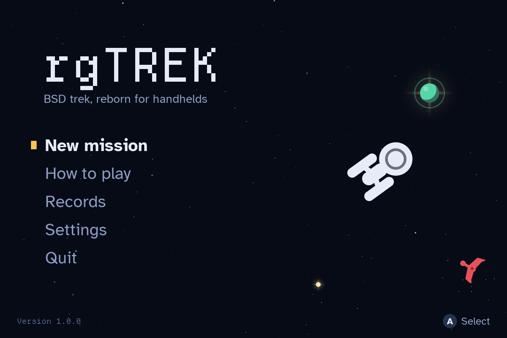
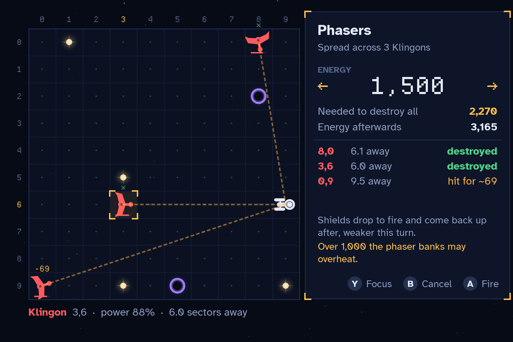
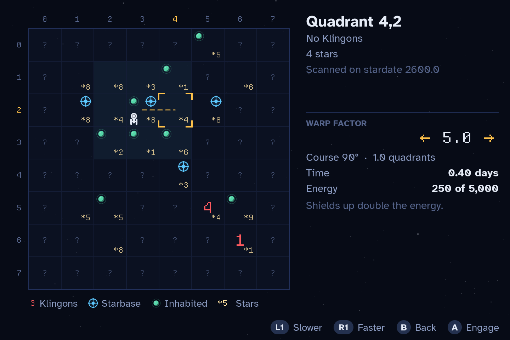
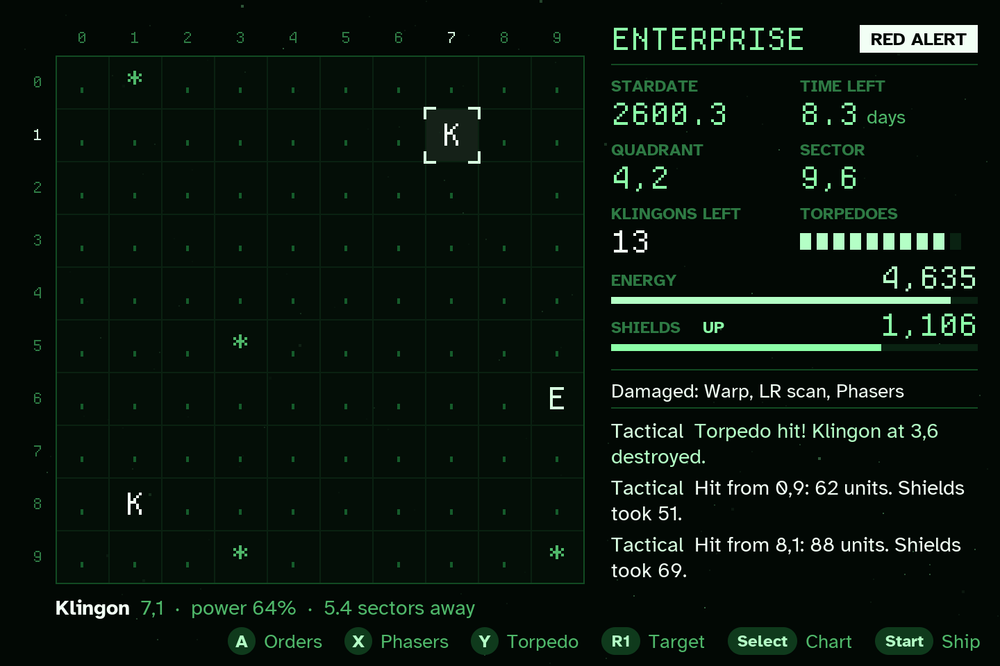

# rgTrek

BSD trek for muOS (MustardOS) handhelds, built with LÖVE 11.5. A recreation of
`trek`, Eric Allman's game from BSD Unix, with the rules intact and a modern
interface: point at things and press a button instead of typing commands. Designed
for the Anbernic RG34XXSP's 720×480 screen and scaled to fit other resolutions.

 
 

## The game

The Klingons are invading. Find and destroy every one of them before time runs out.

The galaxy is 8×8 quadrants of 10×10 sectors, as in BSD trek, and so are the rules:

- **Time** comes from a pool the remaining Klingons drain, so every Klingon you
  destroy buys more of it, and every one built on an enslaved planet costs some.
- **Shields** absorb a hit in proportion to their charge, and warp costs twice the
  energy with them up.
- **Phasers** grow weaker with distance and can't fire through the shields. Firing
  drops the shields and brings them back up, weaker for that turn.
- **Torpedoes** can stray, more with the shields up, and a star they hit may nova,
  destroying whatever is next to it.
- **Klingons** close in, fire after every action you take, lose power each time
  they fire, and may run when badly hurt or surrender when hailed.
- **Damage**: heavy hits damage one of 13 systems. Damaged scanners shrink what
  you can see; a damaged computer lets you fly straight into things; damaged life
  support leaves you living on reserves.
- **Events**: supernovas wipe out quadrants, Klingon tractor beams drag you into
  fights, starbases come under siege, and Klingons enslave planets and build more
  ships there. Distress calls reach you while the subspace radio works.
- **Black holes, warp drive overheating above warp 6, impulse engines, docking,
  resting, cloaking, capturing Klingons, calling for help, abandoning ship for the
  Faire Queene, and self-destruct** are all here, as is BSD trek's scoring and its
  promotion for a good win.
- Six skill levels from Novice to Impossible, and short, medium or long missions.

What's new:

- A cursor-driven bridge. A shows the orders that make sense for what's under the
  cursor, with the cost of each (time, energy, odds) before you commit. The grid
  shows the plotted course, the torpedo's line and spread, or what each phaser
  volley would do.
- A star chart that plots warps: pick a quadrant, set the warp factor and see the
  time and energy before engaging. The navigation computer steers around obstacles.
- Animated combat and travel: phaser beams, torpedoes, explosions, novas, shield
  flashes and warp streaks. Any button skips them.
- The crew report in a colored log (Helm, Tactical, Science, Comms, Engineering,
  Medical), with the full captain's log a menu away.
- Three themes, Deep Space, Phosphor and Amber, and a Classic display that draws
  the sector grid with the original letters: `E` `K` `#` `*` `@`.
- Sound effects synthesized in code, so the game ships no audio files.
- Auto-save after every action, with Continue on the title screen, and a records
  table.
- Battery friendly: the screen is only redrawn when something changes.

## Install on the device

1. Run `./build.sh`, or use a prebuilt `rgTrek_vX.Y.Z.muxapp`.
2. Copy the `.muxapp` to `/mnt/mmc/MUOS/ARCHIVE/` on the SD card.
3. On the device, open **Applications → Archive Manager** and install it.
4. Launch **rgTrek** from Applications.

Saves are stored in `MUOS/application/rgTrek/.game/save/`. If the game doesn't
start, check `MUOS/application/rgTrek/.game/rgtrek.log`.

## Controls

| Button | On the bridge | In the star chart |
|---|---|---|
| D-pad | Move the cursor (hold to repeat) | Pick a quadrant |
| A | Orders for what's under the cursor | Engage warp |
| B | Cursor back to the ship | Back to the bridge |
| X | Phasers | |
| Y | Torpedo at the cursor | |
| L1 / R1 | Previous / next target | Slower / faster warp |
| Select | Star chart | Back to the bridge |
| Start / Menu | Ship menu | |

In the phaser dialog, left and right change the energy by 50, up and down (or L1
and R1) by 250, and Y switches between spreading the volley over every Klingon and
focusing it on the one under the cursor.

The ship menu has the shields, docking, rest, the cloaking device, the damage
report, the captain's log, settings, and under **Emergency** the calls for help,
abandoning ship and self-destruct.

On a PC keyboard: arrows move, Enter/Space is A, Backspace is B, X and Y are X and
Y, Q/E are L1/R1, Tab is Select and Esc is Start.

## Crisp text on the RG34XXSP

The RG34XXSP packs 720×480 into 3.4 inches, about 254 pixels per inch, so text is
small and any blur shows. The layout is designed on a 720×480 canvas, so on this
device one layout unit is exactly one screen pixel, and everything is kept on
whole pixels:

- **Two typefaces, each used where it's sharpest.** Atkinson Hyperlegible sets
  running text at 12 to 30 px with FreeType's normal hinting. Departure Mono, a
  pixel font drawn on an 11 px grid, sets the readouts, coordinates and classic
  sector letters.
- **The pixel font only at whole multiples of its grid** (11, 22, 33, 66 px),
  rasterized with 1-bit hinting, so every design pixel becomes an exact block of
  screen pixels with no antialiasing blur. At other resolutions the size is rounded
  to the nearest multiple instead of being scaled.
- **Fonts are rasterized at the real screen pixel size** and drawn with the inverse
  of the layout scale, so glyphs are never resampled, also on a 2× Retina Mac.
- **Baselines land on a pixel row.** Each font's cap height is measured from its
  rasterizer, and vertical centering is worked out in screen pixels from that, so
  text sits exactly where the layout puts it.
- **Lines, bars, brackets and grid lines are pixel-aligned rectangles**, not
  antialiased lines.
- **Icons are rasterized in Lua** once per screen scale, with per-pixel
  antialiasing at the exact size they're drawn at, and rotated icons are rasterized
  at their angle instead of being turned by the GPU. LÖVE's own filled shapes have
  jagged edges without MSAA, which can't be counted on with the handheld's GLES
  driver.

`RGTREK_LOWDPI=1` on a Mac renders at the device's real 720×480 instead of 2×, for
checking alignment pixel by pixel.

## Development

Requirements: LÖVE 11.5 for running on a PC, LuaJIT or Lua 5.4 for the tests, and
`bash`, `git` and `zip` for building.

```sh
./build.sh run            # play on a PC (720x480 window)
./build.sh run 640x480    # try another resolution
./build.sh test           # game rule tests and 150 bot-played games
./build.sh test 1000      # ...with 1000 bot-played games
./build.sh love           # build/rgTrek.love
./build.sh                # build/rgTrek_vX.Y.Z.muxapp
```

### On macOS

1. Download LÖVE 11.5 for macOS from https://love2d.org and drag `love.app` into
   Applications. If macOS blocks it the first time, right-click it and choose Open.
2. In Terminal, from this folder: `./build.sh run` (it finds `love.app` itself).

Saves go to `~/Library/Application Support/LOVE/rgtrek/`. Delete that folder to
start fresh.

### Tests and harnesses

The rules (`game/src/trek/`) are plain Lua with no LÖVE calls, so the tests run
them directly: setup for every skill and length, movement, weapons, shields,
docking, novas, the clock, saving, and a bot that plays whole games while checking
the galaxy's bookkeeping after every command.

These run the real game and need a display:

- `RGTREK_AUTOSHOT=1 love game` plays through every screen and saves screenshots
  to `shots/` in the save folder.
- `RGTREK_FUZZ=120 love game` presses random buttons for 120 seconds across many
  missions and stops with a traceback on any error.
- `RGTREK_IDLETEST=1 love game` counts frames drawn while idle (should be 0).

### Project layout

```
mux_launch.sh        muOS launcher (sets up SDL, saves, runs LÖVE)
mux_lang.ini         Name and help text shown in the muOS menu
glyph/               Menu icon
screenshots/         Images used in this README (not packaged)
build.sh             Build, test and run commands
tests/               Rule tests and bot games (plain Lua, no LÖVE needed)
game/                The LÖVE game (becomes .game/ in the muxapp)
  main.lua           Scene stack, saving, idle rendering
  src/trek/          The rules, after BSD trek
    game.lua         Galaxy setup, time, scoring, saving
    commands.lua     The captain's commands, and their cost previews
    combat.lua       Klingon attacks and movement, damage, novas, ramming
    events.lua       Supernovas, tractor beams, sieges, enslaved planets
    const.lua        Devices, names, event rates
    rng.lua          Seeded random numbers (saved with the game)
  src/ui.lua         720x480 layout, crisp text, panels, button glyphs
  src/sprites.lua    Icons rasterized per pixel at their drawn size
  src/starfield.lua  Background stars and warp streaks
  src/theme.lua      Deep Space, Phosphor and Amber
  src/sound.lua      Synthesized sound effects
  src/input.lua      Gamepad and keyboard mapping, hold-to-repeat
  src/storage.lua    Settings, records and the saved game
  src/scenes/        Title, new mission, bridge, star chart, orders, phasers,
                     ship menu, rest, damage report, log, settings, help,
                     records and game over
  dev/               Screenshot, fuzz and idle harnesses (left out of builds)
```

### The LÖVE runtime

muOS doesn't include LÖVE, so the muxapp bundles an aarch64 build of LÖVE 11.5
(`bin/love` and `bin/libs.aarch64/`). `build.sh` takes it from
[2048 Plus](https://github.com/saitamasahil/2048plus) (MIT licensed) at a pinned
tag, because that runtime is known to work on muOS H700 devices. To use a different
runtime, set `LOVE_RUNTIME=/path/to/dir` containing `love` and `libs.aarch64/`.

## Credits and licenses

- Game code: MIT (see `LICENSE`)
- After `trek` by Eric Allman, from 4.2BSD
- Atkinson Hyperlegible font by the Braille Institute: SIL Open Font License
- Departure Mono font by Helena Zhang: SIL Open Font License
- LÖVE: zlib license
- Launcher structure and aarch64 runtime: 2048 Plus by saitamasahil (MIT)

Star Trek and its names are trademarks of their owners. rgTrek is an unofficial fan
recreation of the BSD game and isn't affiliated with or endorsed by them.
